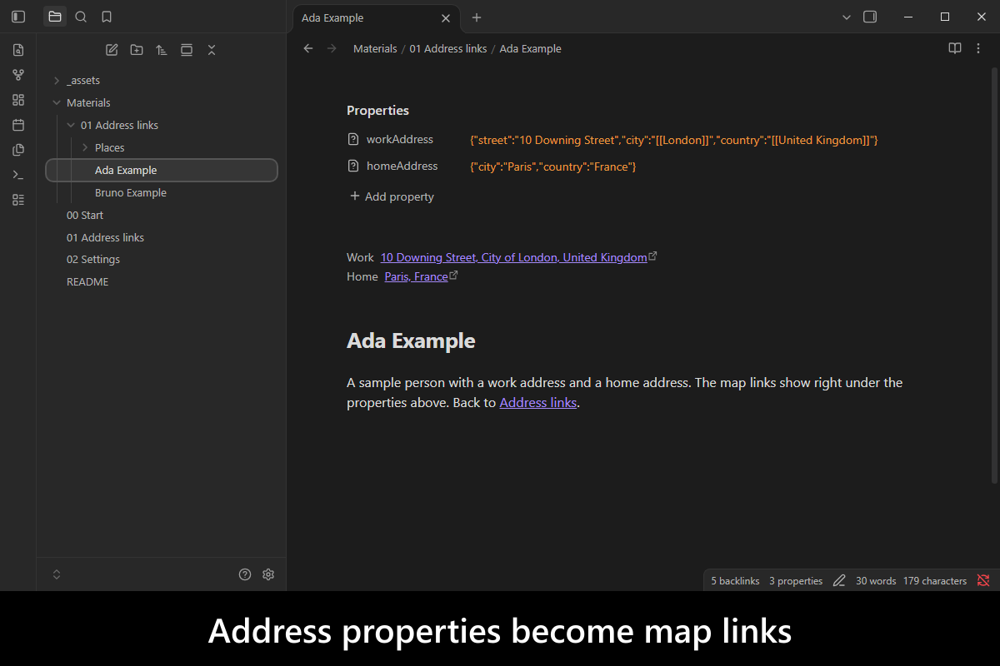
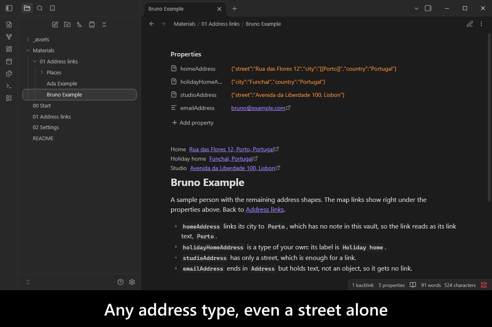
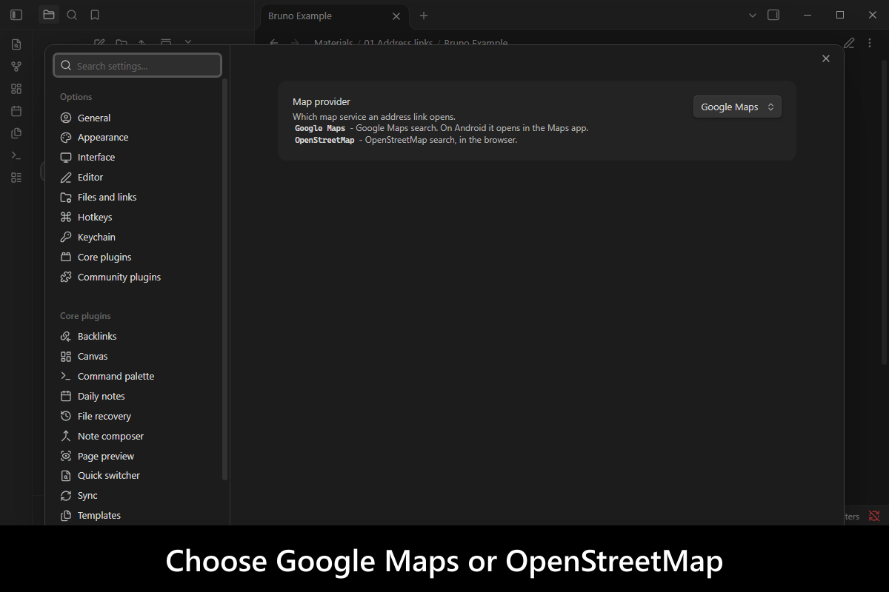
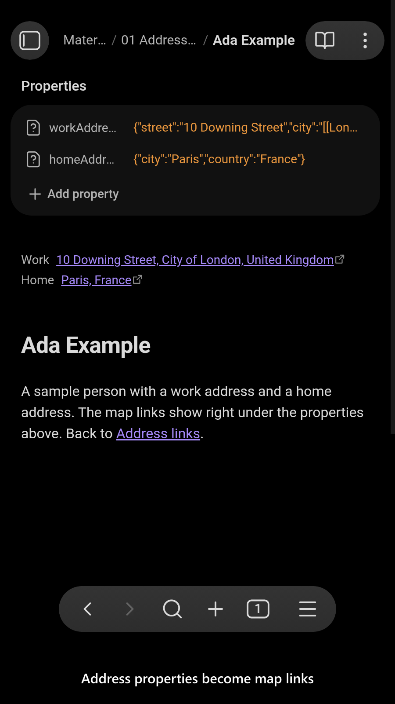
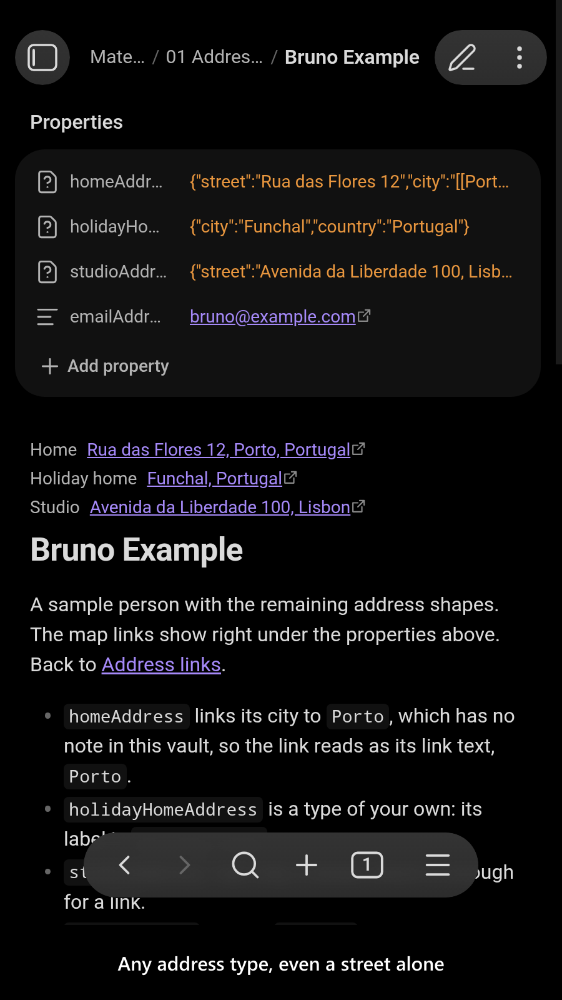
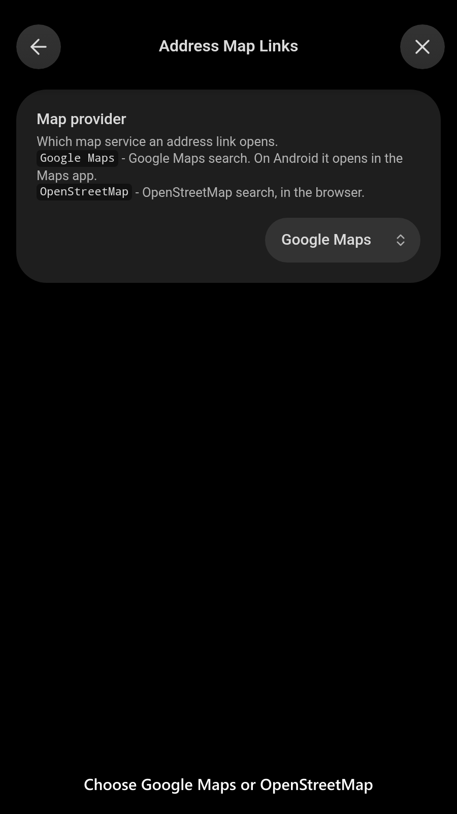

# Address Map Links

   

A person's or a place's note often holds its address, but in Obsidian an address is just text: to see where it is you copy it into a map yourself. A plugin that writes a map link into the note fixes that once, and the stored link goes stale the moment the address changes.

`Address Map Links` reads the address properties a note already has, such as `homeAddress` and `workAddress` with their `street`, `city` and `country`, and shows each one as a clickable map link right under the properties, in Reading view and Live Preview. Nothing is written into the note, so the link always follows the current values, and a `city` or `country` that links to a place note reads as that note's title. Google Maps by default, OpenStreetMap as a setting; on Android a Google Maps link opens the Maps app.

<!-- markdownlint-disable MD033 -->

More screenshots

<!-- markdownlint-enable MD033 -->

## Demo vault

**The documentation is an interactive demo vault.** Every feature has a note that explains what it does and why you would want it, with a button that opens a sample note so you can see the links at once.

**[Start reading here](<./demo-vault/00 Start.md>)** — it is plain markdown, so it works on GitHub with nothing installed.

A copy of the vault ships with every release. You can access it via any of the following:

1. Running the **`Address Map Links`: Open demo vault** command.
2. Downloading `address-map-links-demo-vault.zip` from the [Releases](https://github.com/mnaoumov/obsidian-address-map-links/releases). It unzips into a single `address-map-links-demo-vault-<version>` folder.
3. Browsing its source in [`demo-vault/`](./demo-vault/README.md) in this repository.

## What it does

1. **One map link per address**: every property whose name ends in `Address` and whose value is an object is an address, so `homeAddress`, `workAddress` and any `<type>Address` of your own each get a link, labelled `Home`, `Work` or the type in sentence case: see [Address links](<./demo-vault/01 Address links.md>).
2. **Partial addresses**: `street`, `city` and `country` are all optional, so a city and a country alone, or a street alone, still link.
3. **Place notes**: a `city` or `country` that links to a note reads as that note's `title` property, or its name. A link to a note that does not exist reads as its own text. Rename a place note and Obsidian updates the links, so the map link follows.
4. **Nothing stored**: the link is built from the current properties every time the note is shown. Disable the plugin and the note is still plain properties.
5. **Map provider**: Google Maps or OpenStreetMap, switched live.

Every setting is listed by its `data.json` key in [Settings](<./demo-vault/02 Settings.md>).

The Properties panel does not edit an object value. Edit addresses in Source mode, or with [`Nested Properties`](https://github.com/mnaoumov/obsidian-nested-properties).

## See also

[My other Obsidian resources](https://mnaoumov.dev/obsidian/)

| Plugin | Features | How `Address Map Links` differs |
| --- | --- | --- |
| [`Corduroy`](https://community.obsidian.md/plugins/corduroy) | searches Google Maps and stores the chosen place's coordinates in the frontmatter | Different step: reads addresses you already keep and stores nothing; no search and no coordinates |
| [`Geo Capture`](https://community.obsidian.md/plugins/geo-capture) | captures places, coordinates, map links and photo GPS into travel notes | Different step: renders a link live from address properties instead of capturing data into the note |
| [`Geocode Note`](https://community.obsidian.md/plugins/geocode-note) | looks up an address or the current location and adds coordinates, an icon and a color to the note | Different step: no lookup and nothing written; links the address as text to a map search |
| [`Geocoding Properties`](https://github.com/kepano/obsidian-geocoding-properties) (unlisted) | inserts address and location data from geocoding APIs as properties, map link included, on a command | Same goal as its map link: built when the note is read, so it never goes stale; no geocoding API and no key |
| [`Map Note`](https://community.obsidian.md/plugins/map-note) | adds location notes for the Bases Map view to render | Complements it: one link per address on the note itself, no map view |
| [`Map View`](https://community.obsidian.md/plugins/obsidian-map-view) | an interactive map of the notes that carry coordinates | Complements it: no map inside Obsidian and no coordinates; opens the address in a map service |
| [`Maps`](https://community.obsidian.md/plugins/maps) | a Bases map layout that shows notes as markers | Complements it: needs no coordinates; links each address property to a map search |

Last searched for similar plugins on 2026-11-01.

## Installation

The plugin is not available in [the official Community Plugins repository](https://community.obsidian.md) yet.

### Beta versions

To install the latest beta release of this plugin (regardless if it is available in [the official Community Plugins repository](https://community.obsidian.md) or not), follow these steps:

1. Ensure you have the [BRAT plugin](https://community.obsidian.md/plugins/obsidian42-brat) installed and enabled.
2. Click [Install via BRAT](https://intradeus.github.io/http-protocol-redirector?r=obsidian://brat?plugin=https://github.com/mnaoumov/obsidian-address-map-links).
3. An Obsidian pop-up window should appear. In the window, click the `Add plugin` button once and wait a few seconds for the plugin to install.

## Debugging

By default, debug messages for this plugin (id: `address-map-links`) are hidden.

If you need to enable them refer to the [documentation](https://mnaoumov.dev/obsidian-lib/guides/debugging/).

## Changelog

All notable changes to this project will be documented in the [CHANGELOG](./CHANGELOG.md).

## Contributing

Contributions are welcome — see [CONTRIBUTING](./CONTRIBUTING.md) to get set up.

## Support

<!-- markdownlint-disable MD033 -->

<a href="https://www.buymeacoffee.com/mnaoumov" target="_blank">Support this plugin</a>

<!-- markdownlint-enable MD033 -->

### Filing an issue (for AI agents and humans)

Open issues through the [issue forms](https://github.com/mnaoumov/obsidian-address-map-links/issues/new/choose), not as blank issues.

To report a bug from inside Obsidian, run the **`Address Map Links`: Report a bug** command. It opens the bug form with the plugin version, the Obsidian version and your operating system already filled in.

Filing from the CLI or the API (`gh issue create --body`, or an AI agent filing for you) skips the form, and `gh issue create --template` cannot load an issue form. In that case, open the matching form in [`.github/ISSUE_TEMPLATE/`](https://github.com/mnaoumov/obsidian-address-map-links/tree/HEAD/.github/ISSUE_TEMPLATE), copy every field as a `### <label>` heading in the form's order, and fill in each one. Always state the plugin version, the Obsidian version and your operating system.

## License

© [mnaoumov](https://github.com/mnaoumov/)
